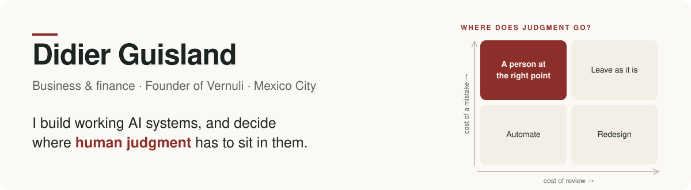

<picture>
  <source media="(prefers-color-scheme: dark)" srcset="assets/header-dark.svg">
  
</picture>

I come from business and finance (Universidad Panamericana; Kroll; Hasta Capital) and studied Technology Leadership & AI at UC Berkeley in summer 2026. I run [Vernuli](https://vernuli.com), where we help non-technical teams turn ideas into AI processes that actually work.

I'm not a traditional software engineer. I build by directing several AI models (Claude as architect, Codex as builder, Gemini for creative direction) with written briefs, tests and review gates. The work moved from typing code to deciding what to build, how to split it, and where a person has to check it. That shift is what I write about.

### Start with the idea

**[The Rising Cost of Judgment](https://didierguisland.github.io/the-rising-cost-of-judgment/)**: an essay (EN/ES) and a method, the Vernuli Matrix, for deciding what to automate and exactly where human judgment has to sit.

### Then the systems that test it

| Project | Where judgment sits |
|---|---|
| **[medication-companion](https://github.com/didierguisland/medication-companion)** Offline Android app that turns an old photo frame into a family medication assistant. | A double dose is unacceptable, so the app never decides: it follows the prescription file, works without internet, and logs who gave each dose. |
| **[ai-video-factory](https://github.com/didierguisland/ai-video-factory)** A production line of AI agents that makes short animated videos. | Fixing a storyboard cost ~$1.20; redoing a finished animation ~$7 (measured). So the human review moved to the storyboard. |
| **[humanify](https://github.com/didierguisland/humanify)** The layer I use every day to coordinate Claude, Codex and Gemini. | Routes each task by how much judgment it needs and what a mistake would cost, and grades delegations so decisions rest on data. |
| **[notchy](https://github.com/didierguisland/notchy)** A native macOS app that lives in the MacBook notch. | A small on-device model writes short lines; it never invents movements. It picks from a closed menu. |

Each repository says plainly what I decided, what the models did, and what a person verified.

**Elsewhere:** [LinkedIn](https://www.linkedin.com/in/didier-guisland) · [Vernuli](https://vernuli.com) · Mexico City
